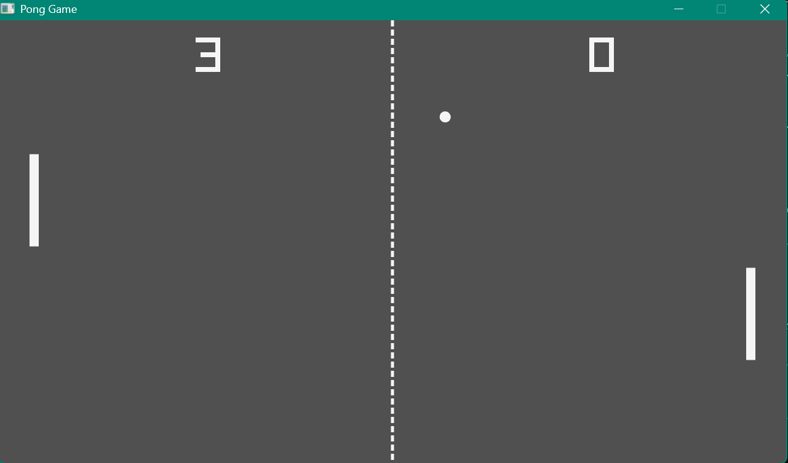

## raylib-go-pong

Classic arcade Pong game written in Go using raylib library

Modes:
* Player vs Player 
* AI vs player

Input:
* Keyboard

---

Sounds: [opengameart.org](https://opengameart.org/)
